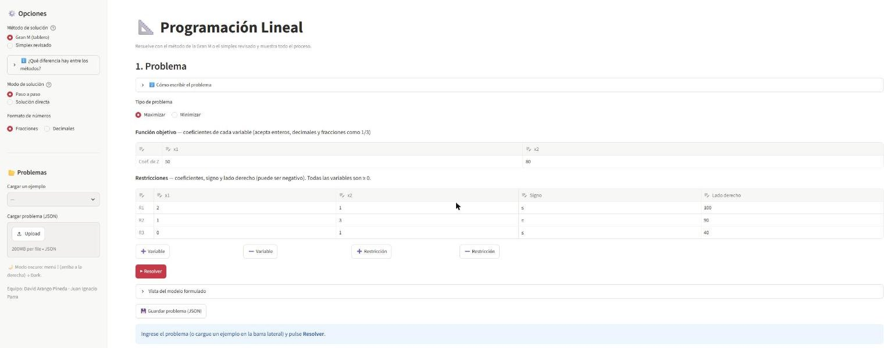
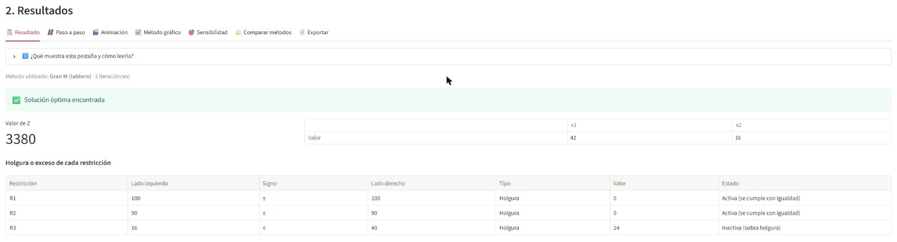
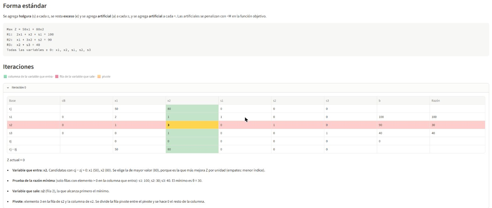
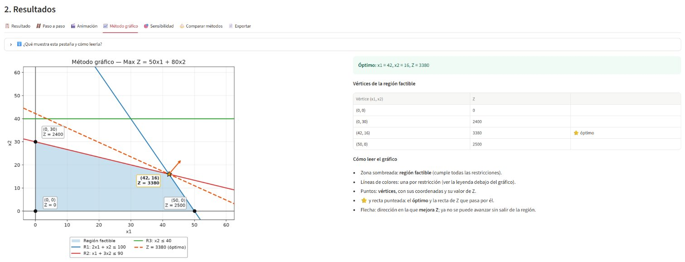
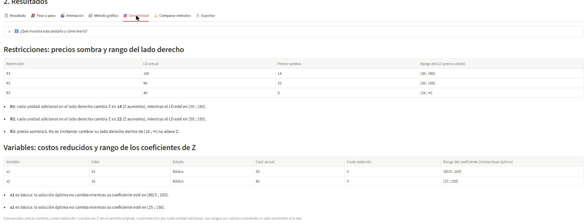
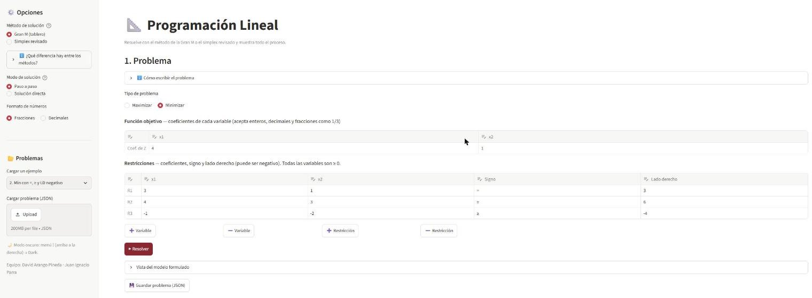
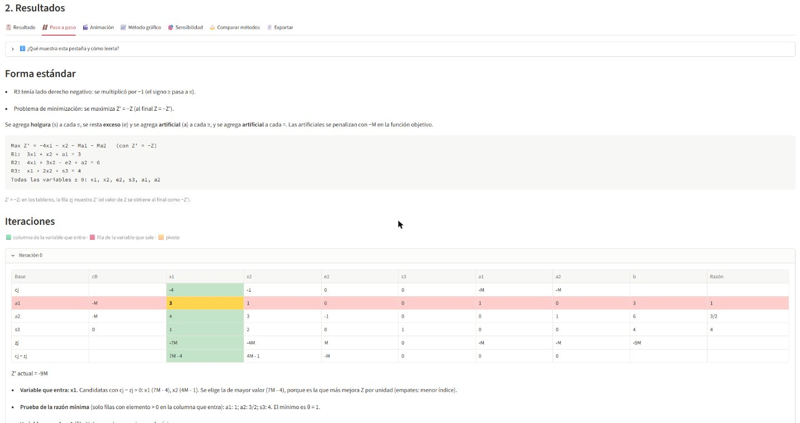
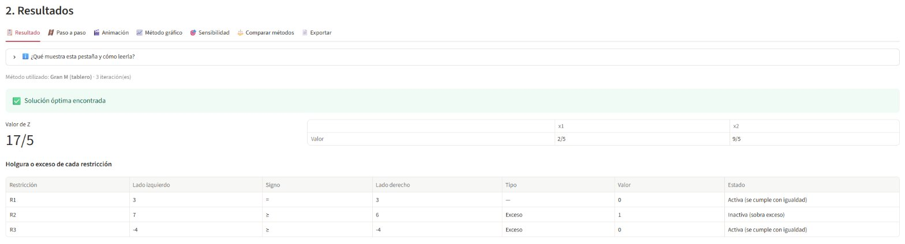
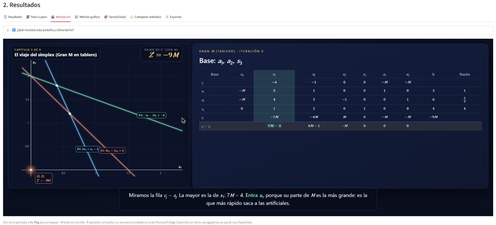

# Manual de usuario — Programación Lineal (Gran M y simplex revisado)

**Equipo:** David Arango Pineda · Juan Ignacio Parra — Optimización, Universidad de Antioquia

La aplicación resuelve problemas de programación lineal con dos métodos propios (Gran M en tablero y
simplex revisado) y muestra todo el proceso: forma estándar, cada iteración justificada, método gráfico,
sensibilidad, una animación narrada y la exportación a PDF.

## 1. Abrir la aplicación

- **En línea, sin instalar nada:** <https://simplex-gran-m-udea.streamlit.app>
- **En el equipo propio:** con Python 3.11 o superior, `pip install -r requirements.txt` y luego
  `streamlit run app.py`; se abre en `http://localhost:8501`.

Cada sección tiene un desplegable **ℹ️** que explica qué muestra y cómo leerla. Para el **modo oscuro**:
menú ⋮ (arriba a la derecha) → *Dark*.

## 2. Ingresar el problema

1. Elija **Maximizar** o **Minimizar**.
2. En **Función objetivo**, escriba el coeficiente de cada variable. Se aceptan enteros, decimales (`2.5`)
   y fracciones (`1/3`).
3. En **Restricciones**, cada fila es una restricción: coeficientes, **signo** (≤, ≥ o =) y **lado derecho**,
   que puede ser negativo. Todas las variables son ≥ 0; no hace falta escribirlo.
4. Con **➕/➖ Variable** y **➕/➖ Restricción** se cambia el tamaño sin perder lo escrito.
5. Pulse **▶ Resolver**. Para cambiar el problema basta editarlo y volver a resolver.

Si un dato está vacío o no es un número, la aplicación indica exactamente cuál es (por ejemplo,
«Valor no numérico en R2, coeficiente de x1: «abc»») y no resuelve hasta que se corrija.

**Barra lateral:** método (Gran M o simplex revisado), modo (paso a paso o solución directa), formato de
números (fracciones o decimales), los 7 ejemplos del enunciado y la carga de un problema guardado en JSON.

## 3. Ejemplo 1: maximización con método gráfico

*Max Z = 50x₁ + 80x₂ s.a. 2x₁ + x₂ ≤ 100; x₁ + 3x₂ ≤ 90; x₂ ≤ 40.*

**Resultado.** Solución óptima x₁ = 42, x₂ = 16, Z = 3380, en 2 iteraciones. R1 y R2 son **activas**
(holgura 0: limitan la solución); a R3 le sobran 24 unidades.

**Paso a paso.** Primero la forma estándar (una holgura s por cada ≤). Luego cada iteración muestra el
tablero con 🟩 la columna que **entra**, 🟥 la fila que **sale** y 🟨 el **pivote**, y debajo la
justificación: entra x₂ porque su cj − zj (80) es el mayor; la razón mínima es 30, así que sale s₂.

**Método gráfico** (solo con 2 variables). Región factible sombreada, una recta por restricción (leyenda
debajo), vértices con su Z, el óptimo ⭐ con la recta de Z que pasa por él y una flecha hacia donde mejora
Z. A la derecha, la tabla de vértices. R3 es **redundante**: no toca la región.

**Sensibilidad.** El **precio sombra** de R1 es 14: cada unidad más de su lado derecho sube Z en 14,
mientras ese lado derecho esté entre 30 y 180. R3 tiene precio sombra 0 porque le sobra holgura. El
coeficiente de x₁ puede moverse entre 80/3 y 160 sin que cambie la solución óptima.

## 4. Ejemplo 2: minimización con =, ≥ y lado derecho negativo

*Min Z = 4x₁ + x₂ s.a. 3x₁ + x₂ = 3; 4x₁ + 3x₂ ≥ 6; −x₁ − 2x₂ ≥ −4.*

**Forma estándar y Gran M.** La aplicación explica cada transformación: R3 tiene lado derecho negativo, así
que se multiplica por −1 y el ≥ pasa a ≤; como se minimiza, se maximiza Z′ = −Z. La igualdad recibe una
**artificial** a₁; el ≥ recibe un **exceso** e₂ y una artificial a₂. Las artificiales cuestan −M: la
aplicación no le da un valor a M, sino que guarda cada costo como *a + b·M*. En la iteración 0 entra x₁
(cj − zj = 7M − 4, la mayor parte de M) y sale a₁ (razón mínima 1).

**Resultado.** x₁ = 2/5, x₂ = 9/5, Z = 17/5, en 3 iteraciones, con fracciones exactas. R2 queda con un
exceso de 1.

## 5. Animación, comparación y exportar

**🎬 Animación.** «El viaje del Simplex» explica el problema resuelto en 8 capítulos animados y narrados:
problema y región, forma estándar, Gran M en tablero, simplex revisado, artificiales, sensibilidad, casos
especiales y resultado. Clic en la portada o **Av Pág** para avanzar, **1–8** para ir a un capítulo, **H**
de corrido, **F** pantalla completa. La voz recomendada es Salomé, de Microsoft Edge.

**⚖️ Comparar métodos.** Las iteraciones de la Gran M y del simplex revisado lado a lado: usan la misma
regla, así que recorren las mismas bases y llegan al mismo resultado.

**📄 Exportar.** PDF con el problema, la forma estándar, todas las iteraciones, la solución, la
sensibilidad y el gráfico; y la animación como archivo HTML para verla sin internet.
**💾 Guardar problema (JSON)** guarda los datos para cargarlos después desde la barra lateral.

## 6. Casos especiales

La aplicación nunca falla con un error: informa el caso con un mensaje claro.

| Caso | Qué se ve |
|---|---|
| **Infactible** | «El problema no tiene solución factible»; el gráfico sombrea cada restricción y muestra que no hay región común. |
| **No acotado** | «La solución es no acotada»; el gráfico dibuja una flecha hacia donde Z crece sin límite. |
| **Óptimos múltiples** | Se indica el segmento de soluciones óptimas (por ejemplo, entre (0, 5/2) y (3, 1) con Z = 10). |
| **Degenerado** | Se avisa que una variable básica vale 0 y se marca el empate en la razón mínima. |
| **Más de 2 variables** | El método gráfico indica que no aplica; el resto funciona igual. |
